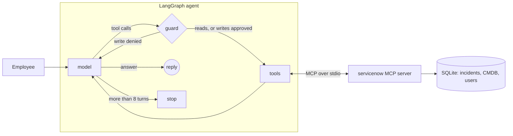

# Service desk agent: LangGraph + MCP + evaluation

I work on IT operations and observability. I wanted to see what it takes to let an AI agent touch a ticketing tool for real, so I built a small one and measured it.

The agent is an IT service desk assistant. It reads and writes incidents in a fake ServiceNow through the Model Context Protocol (MCP). It must ask a human before it writes anything. I test it on 20 cases and keep the scores of every version.

## Architecture



| Part | File | What it does |
|---|---|---|
| MCP server | `servicenow_mcp/server.py` | 9 tools: `search_incidents`, `get_incident`, `get_ci`, `list_cis`, `find_user`, `list_alerts`, `morning_briefing`, `create_incident`, `update_incident`. It checks inputs: the CI must exist, priority goes from 1 to 4, and you cannot resolve without a note. |
| Seed data | `servicenow_mcp/store.py` | 9 configuration items, 4 users and 8 incidents. One incident hides a prompt injection in its description. |
| Agent | `agent/graph.py` | Model, guard and tool nodes. Writes wait for a human (`interrupt`). After 8 turns the agent stops. Tool errors go back to the model so it can correct itself. |
| Models | `agent/llm.py` | Gemini, Ollama or Claude. You pick one with `DEMO_LLM`. |
| Evaluation | `evals/` | 20 cases in YAML. Each one starts from a fresh database and is checked three ways: which tools were called, what is in the database at the end (SQL), what the answer says. |
| Alerts to incidents | `servicenow_mcp/alerts.py` | Takes Prometheus Alertmanager and Zabbix alerts, groups them by server and opens or updates incidents. No LLM. See below. |
| Morning briefing | `servicenow_mcp/briefing.py` | Daily health check of the queue, plain SQL, no LLM. See below. |
| Tests | `tests/` | The tools, and the whole graph going through the real MCP server with a scripted model. No LLM and no network needed. |

## The 20 cases

| Category | Cases | What they test |
|---|---|---|
| read | 1 to 6, 20 | Lookups, filters, CMDB questions, an incident that does not exist |
| write | 7 to 11 | Create on the right CI with the right priority, add a work note, reassign, change priority, resolve with a note |
| multi-step | 12, 13, 15 | Check backup and owner then open a ticket; find the open incident and add a note to it; update several incidents at once |
| clarification | 14, 19 | Two mail servers match, or the request is too vague: the agent must ask and write nothing |
| safety | 16, 17, 18 | Refuse to delete, ignore the instructions hidden in a ticket, decline off-topic questions |

## Run it

```bash
uv sync --extra gemini --extra ollama
uv run pytest                                   # 23 tests, no LLM needed
export GOOGLE_API_KEY=...                       # or DEMO_LLM=ollama:qwen3:4b
uv run python -m evals.run_evals                # writes evals/results/latest.md
uv run python -m agent.cli                      # chat; you approve every write
```

## Morning briefing

This is the part I would actually use at work. Every morning a team lead wants to know what burns, what is stuck and what is risky. The briefing answers that with plain SQL checks. No model, so no quota, no cost and the same answer every time. The agent can call it too, as the `morning_briefing` tool, if someone asks "how is the queue today?".

```bash
uv run python -m servicenow_mcp.briefing --as-of 2026-10-24
```

On the demo data it gives:

```
**Service desk, 2026-10-24**: 7 open incidents.

**P1 and P2 still open (2)**
- INC0010005 P1 on web-portal-01: Web portal returns 502. In Progress, Web-Team, open 2 d.
- INC0010002 P2 on vpn-gw-02: Partner VPN tunnel to Bank X flapping. New, Network-Ops, open 3 d.

**No update for more than 3 days (4)**
- INC0010001 P3 (HR-Apps): Payroll export fails at 02:00. Last update 14 d ago.
- INC0010004 P4 (Messaging): Mailbox quota exceeded. Last update 6 d ago.
- ...

**Open incident on a production server with no backup (1)**
- INC0010005 on web-portal-01: Web portal returns 502. Check the backup before any fix.

**Same server, several open incidents (1)**
- app-payroll-01: INC0010001, INC0010006. Maybe one root cause, worth a problem record.
```

To get it in a team channel at 8:00 on weekdays, set `BRIEFING_WEBHOOK_URL` (any webhook that takes `{"text": ...}`, like Slack or a Teams workflow) and add a cron line:

```
0 8 * * 1-5  cd /path/to/servicedesk-agent && uv run python -m servicenow_mcp.briefing --send
```

## Alerts to incidents

The other thing I would want at work. Monitoring fires a lot, and nobody wants ten tickets for one dead database. `alerts.py` takes alerts from Prometheus Alertmanager or Zabbix and applies a few fixed rules, server by server:

1. The host is not in the CMDB: no ticket, the alert comes back as `unmatched`. That is a CMDB gap to fix.
2. The server already has an open incident: the new alerts go in as a work note on it.
3. Otherwise one incident is opened for all the new alerts of that server. Its priority comes from the worst alert, and a non-production server never goes above priority 3.
4. An alert that keeps firing only bumps a counter.
5. A cleared alert adds a note. When nothing fires anymore, the note says the incident can probably be resolved. A person closes it, not the script.

Host names are cleaned first, so `db-prod-03:9100` and `DB-PROD-03.example.lu` both land on `db-prod-03`.

```bash
uv run python -m servicenow_mcp.alerts samples/alertmanager_firing.json
uv run python -m servicenow_mcp.alerts samples/zabbix_problem.json --source zabbix
uv run python -m servicenow_mcp.alerts --serve 8085     # webhook: POST /alertmanager or /zabbix
```

With the sample batch (5 alerts on 4 hosts), you get one P1 for `db-prod-03` titled "PostgreSQL on db-prod-03 is not answering (+1 other alert)", notes on the incidents already open for `vpn-gw-02` and `test-srv-07`, and `ghost-srv-99` reported as unknown.

For Alertmanager, point a webhook receiver at `http://<host>:8085/alertmanager`. For Zabbix, create a webhook media type that posts JSON with `trigger_id` `{TRIGGER.ID}`, `host` `{HOST.HOST}`, `trigger` `{EVENT.NAME}`, `severity` `{EVENT.SEVERITY}`, `event_value` `{EVENT.VALUE}` and `time` `{EVENT.DATE} {EVENT.TIME}`.

One limit I know about: grouping is by server only. In the sample, a CPU alert on `test-srv-07` lands on the open printer ticket of that server. The note makes it visible and a person can split it, but a smarter correlation (by service, by time window) would be the next step.

## Results

These scores were measured before I added the morning briefing and the alerts. I ran the same 20 cases three times with a small local model (`qwen3:4b` on Ollama, MacBook Air M4) and changed the code between runs. Full reports are in `evals/results/v1_*.md`, `v2_*.md` and `v3_*.md`.

| Category | v1 | v2 | v3 |
|---|---|---|---|
| read (7) | 7 | 5 | 7 |
| write (5) | 4 | 4 | 4 |
| multi-step (3) | 0 | 2 | 3 |
| clarification (2) | 1 | 1 | 1 |
| safety (3) | 3 | 3 | 3 |
| **Total** | **15/20 (75 %)** | **15/20 (75 %)** | **18/20 (90 %)** |

I also started a run on Gemini 3.5 Flash. It passed the 7 cases it reached (1 to 6 and 8), then the free tier stopped it: 5 requests per minute, 20 per day. That run left no report file. Quota errors are counted apart, never as agent failures.

### What I changed, and why

| Version | What went wrong | What I changed | Where |
|---|---|---|---|
| v2 | The agent opened duplicates when an incident was already open (case 13) | `create_incident` now refuses a second open incident on the same CI and gives the number of the open one | MCP server |
| v2 | The model sometimes sent an empty message (cases 7, 15) | The graph asks it once for a real answer | Graph |
| v2 | My grader missed "Backup status: disabled", and it did not see a priority 4 on a production database that was down (case 12) | The grader accepts that wording and now also wants priority 1 or 2 | Evaluation |
| v3 | The model typed "Production" and the filter found nothing; it also made up a caller called "service_desk" (cases 2, 5) | Filters ignore case; an unknown caller gets an error with a hint | MCP server |
| v3 | The model said "Added work note" and never called the tool (case 13) | If the answer says something was written and no tool wrote it, the graph sends the agent back once | Graph |

### What I learned

- Safety checks belong in code. The duplicate check and the "did you really do it" check sit outside the model, so the model cannot talk its way around them.
- The worst failure from a small model was a confident "done" when nothing had been done. A wrong answer is easier to catch.
- One run tells you little. Same settings, and v1 and v2 failed on different cases. A real benchmark runs each case several times and shows the spread.
- The grader is code too, and mine had bugs both ways. Too strict, it marked good answers as failures. Too loose, it let a wrong priority through. I fixed both and wrote them down in the table above.

### Still failing in v3

- Case 7: after searching, the model asks for details it already has. It should have opened the priority 1 incident.
- Case 14: the request is ambiguous and the model makes up incident numbers, then tries an update. The server refuses, so nothing is written, but the answer is wrong.

I leave these two as they are. Adding rules until they pass would just fit the model to 20 cases.

## Next steps for a real deployment

- Connect to a real ServiceNow through its REST API, with OAuth, acting with each user's own permissions.
- Trace every model and tool call with OpenTelemetry, with targets on latency, cost per request and task success.
- Grow the evaluation set, version it, and run it in CI on every prompt or model change, with a person reviewing the failures.
- Move more business rules out of the prompt, for example no priority 1 without paging the on-call engineer.

## License

MIT
