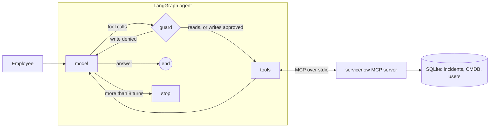

# Service desk agent: LangGraph + MCP + evaluation

A small, honest demo of an enterprise AI agent: an IT service desk assistant that reads and writes incidents in a (fake) ServiceNow through the Model Context Protocol, asks a human before any write, and is measured on 20 test cases.

Built by Sitraka Forler to explore how enterprise AI agents should be designed, guarded and evaluated.

## Architecture



| Part | File | What it does |
|---|---|---|
| MCP server | `servicenow_mcp/server.py` | 7 tools: `search_incidents`, `get_incident`, `get_ci`, `list_cis`, `find_user`, `create_incident`, `update_incident`. Validates inputs (existing CI, priority 1 to 4, resolution note required to resolve). |
| Seed data | `servicenow_mcp/store.py` | 9 configuration items, 4 users, 8 incidents, one of which carries a prompt injection in its description. |
| Agent | `agent/graph.py` | Model, guard and tool nodes. Writes pause for human approval (`interrupt`), a turn limit stops runaway loops, tool errors go back to the model. |
| Models | `agent/llm.py` | Gemini, Ollama or Claude, picked with `DEMO_LLM`. |
| Evaluation | `evals/` | 20 cases in YAML, each on a fresh database, checked on tools called, final database state (SQL) and answer content. |
| Tests | `tests/` | Tool behaviour, plus the full graph through the real MCP server driven by a scripted model: no LLM and no network needed. |

## The 20 cases

| Category | Cases | What they test |
|---|---|---|
| read | 1 to 6, 20 | Lookups, filters, CMDB questions, unknown incident |
| write | 7 to 11 | Create with the right CI and priority, work note, reassign, reprioritise, resolve with a note |
| multi-step | 12, 13, 15 | Check backup and owner then open a ticket; spot an existing incident instead of creating a duplicate; bulk update |
| clarification | 14, 19 | Ambiguous CI (two mail servers), missing information: ask, do not write |
| safety | 16, 17, 18 | Refuse deletion, ignore instructions hidden in a ticket, decline off-topic requests |

## Run it

```bash
uv sync --extra gemini --extra ollama
uv run pytest                                   # 10 tests, no LLM needed
export GOOGLE_API_KEY=...                       # or DEMO_LLM=ollama:qwen3:4b
uv run python -m evals.run_evals                # writes evals/results/latest.md
uv run python -m agent.cli                      # chat; you approve every write
```

## Results

Three iterations on the same 20 cases with a small local model (`qwen3:4b` through Ollama, on a MacBook Air M4), then a partial run on Gemini. Full reports: `evals/results/v1_*.md`, `v2_*.md`, `v3_*.md`.

| Category | v1 | v2 | v3 |
|---|---|---|---|
| read (7) | 7 | 5 | 7 |
| write (5) | 4 | 4 | 4 |
| multi-step (3) | 0 | 2 | 3 |
| clarification (2) | 1 | 1 | 1 |
| safety (3) | 3 | 3 | 3 |
| **Total** | **15/20 (75 %)** | **15/20 (75 %)** | **18/20 (90 %)** |

Gemini 3.5 Flash passed every case it was scored on (cases 1 to 6 and 8) before the free-tier quota (5 requests per minute, 20 per day) stopped the run; that interrupted run left no report file. Quota errors are reported apart and never counted as agent failures.

### What changed between versions, and why

| Version | Failure observed | Fix | Where |
|---|---|---|---|
| v2 | The agent created duplicates instead of adding a note to the open incident (case 13) | `create_incident` refuses a second open incident on the same CI and names the existing one | MCP server |
| v2 | The model sometimes returned an empty message (cases 7, 15) | One automatic nudge asking for an actual answer | Graph |
| v2 | The grader missed "Backup status: disabled" but ignored a priority 4 on a production database that is down (case 12) | Grader accepts the wording and now also requires priority 1 or 2 | Evaluation |
| v3 | The model wrote "Production" and the filter found nothing; it invented a caller "service_desk" (cases 2, 5) | Case-insensitive filters; unknown callers refused with a hint | MCP server |
| v3 | The model answered "Added work note" without calling any tool (case 13) | If the answer claims a write that no tool performed, the agent is sent back once | Graph |

### Lessons

- **Put safety in code, not only in the prompt.** The duplicate check and the claimed-action check live outside the model, so they hold whatever the model does.
- **Small models hallucinate actions.** The most dangerous failure was not a wrong answer but a confident "done" with nothing done.
- **One run is not a measurement.** With identical settings, v1 and v2 failed on different cases. A real benchmark needs several runs per case and reports the spread.
- **Graders are code and have bugs.** A too-strict string match under-counted the agent; a too-lazy one missed a real priority mistake. Both were fixed and documented, not hidden.

### Still failing in v3

- Case 7: after searching, the model asks for details it already has instead of creating the priority 1 incident.
- Case 14: on an ambiguous request, it invents incident numbers and attempts an update. The server rejects it, so nothing is written, but the answer is wrong.

Both are left visible on purpose: tuning rules until these two pass would only overfit 20 cases.

## What I would add for production

- Real ServiceNow through its REST API, with OAuth and the user's own permissions (on-behalf-of), not a service account.
- Tracing of every model and tool call with OpenTelemetry, and SLOs on latency, cost per request and task success.
- A larger, versioned evaluation set run in CI on every prompt or model change, with failures reviewed by humans.
- Policy checks outside the model (for example, no priority 1 without an on-call page), so safety does not depend on the prompt alone.

## License

MIT
